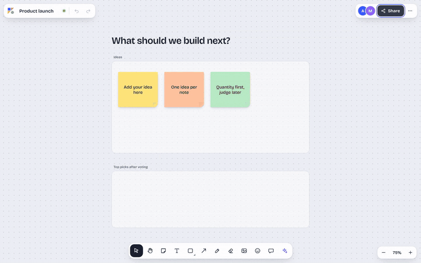
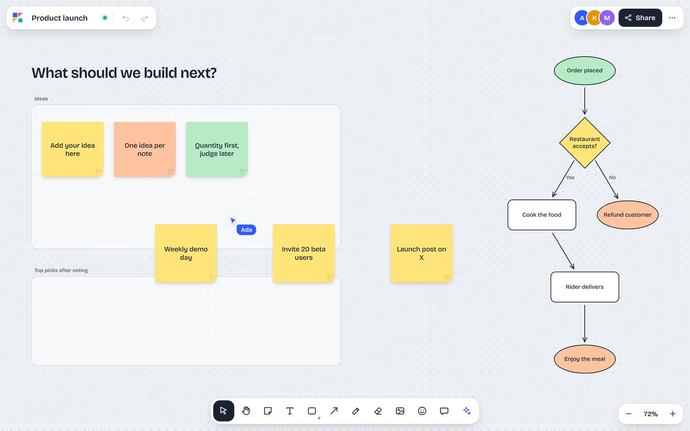
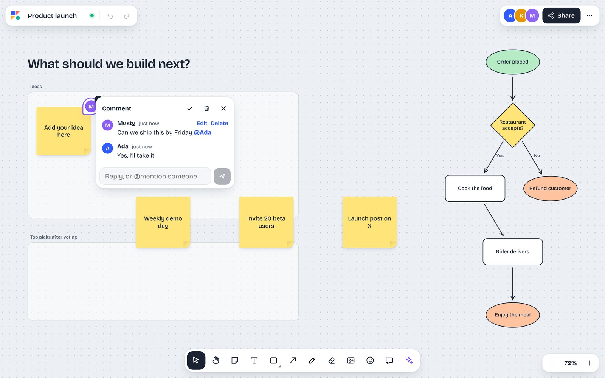
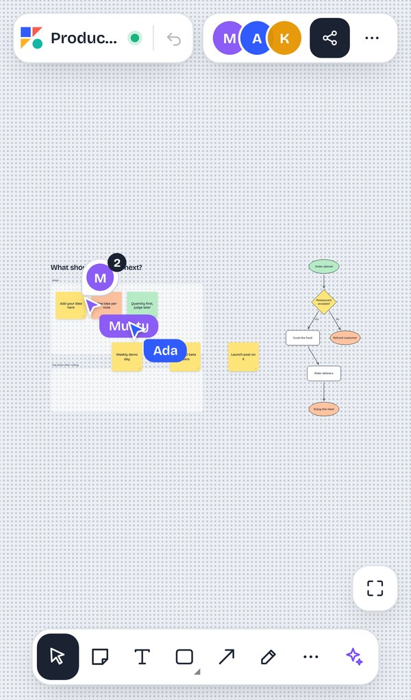
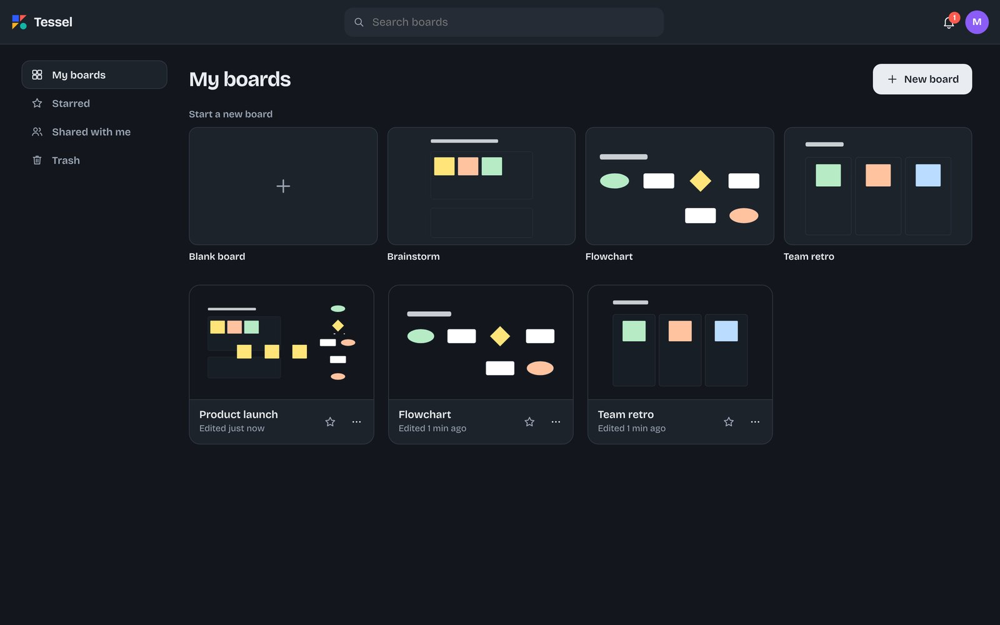
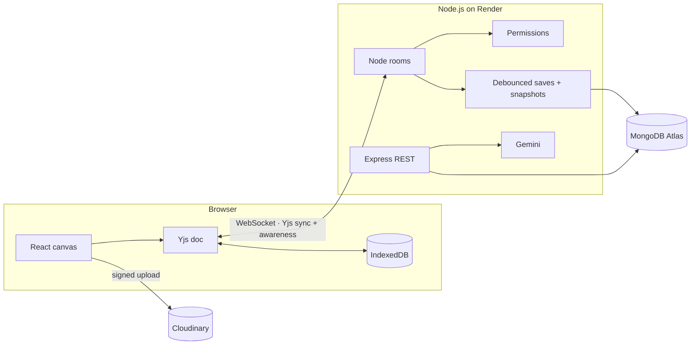

# Tessel

**A live, multiplayer whiteboard.** Sticky notes, shapes, arrows, drawing and photos on an infinite canvas, with everyone's cursor on screen, AI that sorts and draws for you, comments with @mentions, and a board that keeps working offline.

**Try it:** [musty325199.github.io/tessel](https://musty325199.github.io/tessel/) · no account needed for the practice board



| Board with live cursors and an AI-drawn flowchart | Comments and @mentions |
|---|---|
|  |  |

| On a phone | Dashboard (dark mode) |
|---|---|
|  |  |

## Features

**Canvas**
- Sticky notes, text, rectangles, circles, diamonds, frames, freehand pen, photos
- Arrows that stay attached to shapes and clip to their outline (rectangle, ellipse and diamond maths)
- Text formatting: four fonts, sizes, bold/italic/underline/strikethrough, alignment, bullet and numbered lists, text colour and highlight; notes grow to fit their text
- Infinite canvas with pinch-zoom, two-finger pan, marquee select, resize, duplicate, layering, undo/redo, keyboard shortcuts
- Phone first: named, touch-sized tools, a formatting bar you can drag anywhere (and that moves above the keyboard), the note being edited scrolls into view, a short first-time tour
- Installable: add it to the home screen and it opens full screen, even with no signal (service worker + web manifest)

**Together**
- Live cursors with names, presence avatars, other people's selections, follow someone's view
- Emoji reactions and cursor chat
- Comments pinned to shapes (they move with the shape), threads, resolve, edit, @mention autocomplete, notifications and email
- Shared timer that ends at the same moment on every device, voting rounds with hidden votes and ranked results, presenting frames with followers

**AI** (Gemini)
- Organise notes into themed frames · summarise a board · draw a flowchart from a sentence · grow ideas around a note
- Structured JSON output, layouts computed in code, results placed in free space, a version saved before AI changes

**Your work is safe**
- Works offline: every board lives in IndexedDB and merges with everyone's changes on reconnect
- Version history: automatic snapshots plus named versions, preview and restore (restores are undoable)
- Share by email with roles, or by link (view or edit); owners can revoke instantly

**Out of the app**
- Export the board, a frame or a selection as PNG or PDF with a live preview; phones get the share sheet
- Photos resized in the browser and uploaded straight to Cloudinary

## How it works



- **CRDT, not locks.** Each board is a Yjs document. Edits apply locally first, so the UI never waits on the network and two people moving the same note never conflict. Each shape is its own `Y.Map`, so one person changing a colour and another moving the note both win.
- **A real sync server.** The server speaks the Yjs sync and awareness protocols over WebSockets itself (no hosted service). The first frame carries the access token, so tokens never appear in URLs or logs. Viewers can read, but their updates are dropped on the server.
- **Saving.** Writes are debounced (1.5 s, never more than 8 s apart while editing). Every 10 minutes of activity creates an automatic version; the last 40 are kept. Dashboard thumbnails are SVGs drawn on the server from the CRDT.
- **Access control.** Owner, editor and viewer roles, plus link access. Changing someone's access re-checks live connections at once.
- **Auth.** bcrypt passwords, 15-minute JWTs kept in memory, rotating single-use refresh tokens stored as SHA-256 hashes, timing-safe login, rate limits. Password reset links are single-use, expire in 30 minutes, are stored only as hashes, never reveal whether an email has an account, and sign out every other device.
- **Shared session state.** Timers, votes and presenting live in the doc (or in awareness), so they sync and survive refreshes with no extra endpoints. Timers use the server clock offset from the WebSocket handshake.
- **Exports** are drawn by a canvas renderer (text wrapping, fonts, arrows, pen strokes, images) rather than screenshotting the DOM, so they match on every device.

Full API and WebSocket protocol: [docs/API.md](docs/API.md) · Design decisions and trade-offs: [docs/CASE_STUDY.md](docs/CASE_STUDY.md)

## Stack

**Web:** React 18, TypeScript, Vite, Yjs, y-protocols, y-indexeddb, perfect-freehand, jsPDF  
**Server:** Node.js, Express, ws, Zod, MongoDB driver, bcrypt, JWT, Gemini REST, Resend, Cloudinary  
**Quality:** Vitest + Supertest (API, permissions, real WebSocket sync between clients, AI layouts), Playwright (desktop and iPhone), GitHub Actions  
**Hosting (all free tiers):** GitHub Pages, Render, MongoDB Atlas, Cloudinary, UptimeRobot

## Run it locally

```bash
# API: uses in-memory storage when MONGODB_URI is not set
cd server && npm install && npm run dev

# Web app
cd web && npm install && npx vite        # http://localhost:5173
```

`server/dev-fake-ai.ts` starts the API with a fake AI model, for working on the AI UI without a key.

| Server variable | Purpose |
|---|---|
| `MONGODB_URI` | Database (required in production) |
| `JWT_SECRET` | Token signing key (required in production) |
| `CLIENT_ORIGIN` | Allowed web origins, comma separated |
| `GEMINI_API_KEY` | AI features |
| `CLOUDINARY_URL` | Photo uploads |
| `RESEND_API_KEY`, `MAIL_FROM` | Emails for @mentions |

## Tests

```bash
cd server && npm test             # API, roles, live sync, comments, AI layouts, upload signing
cd web && npx playwright test     # the real app in Chrome and an iPhone viewport
```

The sync tests connect real WebSocket clients: two editors see each other's changes, a viewer's edits never reach anyone, and a restored version reaches everyone and is saved.

## Deploy

- `render.yaml` / `Dockerfile` run the API on Render's free plan.
- `.github/workflows/ci.yml` runs the unit and browser tests on every push, then publishes the web app to GitHub Pages.

---

Built by Musty in Lagos.
